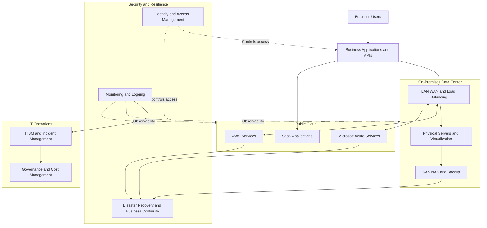

# Enterprise Infrastructure Reference Architecture

This conceptual diagram shows how business applications connect to data center infrastructure, hybrid cloud, security and IT operations.

## Architecture Notes

- The diagram is illustrative, not a deployment blueprint.
- Actual network connectivity and security boundaries depend on organizational requirements.
- Disaster recovery must be designed around business-approved RTO and RPO targets.
- Monitoring, ITSM, identity controls and governance span the infrastructure environment.
